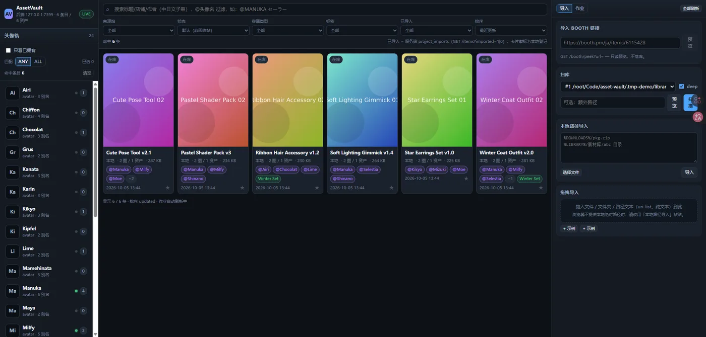
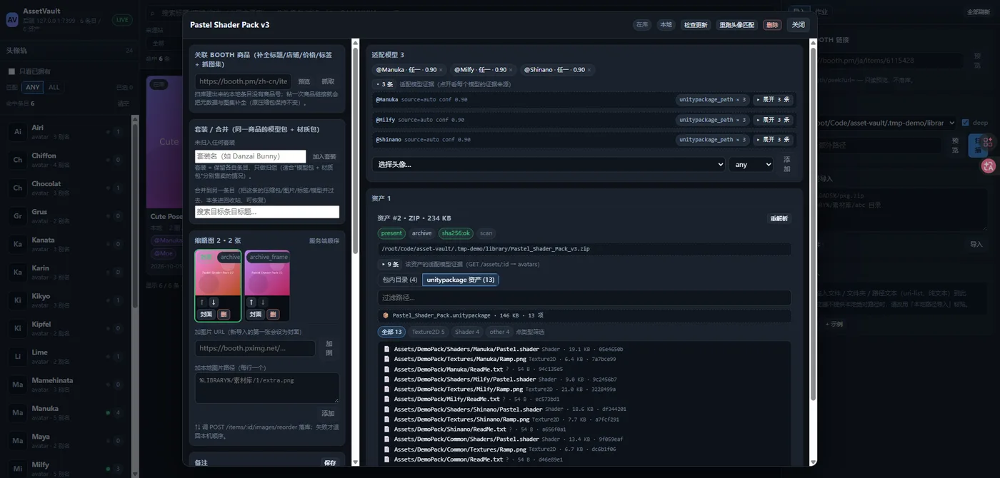
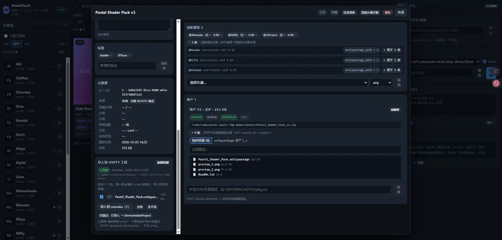

事先声明本项目目前仅由我本人需求进行构建，完全是许愿式编程，不喜欢可以绕道走，有想法欢迎提，谢谢配合。
# AssetVault · 资源库

[](LICENSE)
[](https://nodejs.org)
[](#-快速开始)
[](#-测试与验收)

> 把散落在各个下载目录里的 BOOTH / Unity / VRChat 素材，收成一个**可检索、能直接导进 Unity** 的本地资源库。

每条素材会记下**来源商品**、**多张缩略图**、**关联的压缩包与 unitypackage**、**适配哪些 avatar**，
并回答三个每天都在问的问题：**这个素材是给哪个模型的 / 我导入过没 / 上游更新了没**。

本地优先：无云、无账号、默认**就地索引**，不搬动也不删除你的原始文件。

`Node 22+` · `Windows 便携版（Electron）` · `SQLite 单文件` · `无需任何外部服务`

---

## ✨ 特性

| 能力 | 说明 |
|---|---|
| **扫库建档** | 扫目录 → 从文件名/文件夹名抽 BOOTH 商品号 → 回查商品页补全标题/作者/分类/标签/图集；没商品号的进 `inbox` 待人工确认（**宁缺勿错**） |
| **粘贴链接建档** | 支持 `booth.pm/{lang}/items/<id>`、`<shop>.booth.pm/items/<id>`、裸 ID；带 peek 只读预览 |
| **多缩略图** | BOOTH 官方图集 + 包内 `preview.png` + 压缩包内图片帧 + 用户自加图，统一转 webp 缩略图（卡片永远有图，不用 hover） |
| **压缩包内浏览** | zip/7z/rar **不解压**列目录、直读单条目预览；**内层压缩包可点开**（`▸ 📦` 展开一层），不再只看到一行 `xxx.zip` |
| **unitypackage 解析** | **不启动 Unity**：gzip+tar 读 `pathname` → 资产路径树 + 类型统计；压缩包**里面**的 .unitypackage 同样解析（实测 463MB 的包 328 项、MANUKA 165 GUID） |
| **包内文件预览** | `Assets/…/ReadMe.txt` / `.mat` / `.asset` / `.prefab` / `.anim` 点一下就能看（Unity 这些本来就是 YAML 文本）；图片走图片预览，真二进制会明确说不预览 |
| **avatar 维度** | 一条素材可适配多个模型；6 类证据（标题 / BOOTH 标签 / 描述 / 包内路径 / unitypackage 路径 / 文件名）自动打分，别名单表归一 |
| **自动校准** | 只要**包内容**里认出了某些模型，就按内容口径算适配；只在商品页标签里出现过的不算（商品页声明另存为「声明适配」）。**通用工具类素材**（插件/姿势/着色器）不吃这套 |
| **按 avatar 快筛** | 头像轨点选即过滤，多选支持 **ANY / ALL**；`@Manuka 裙子` 语法；只看已拥有 |
| **分类体系** | **15 个一级分类 / 80 个二级子分类**（服饰·妆容·头发·模型·材质与纹理·Shader·动画与动作·特效·工具·饰品·音频·场景·UI·其他·**未分类**），分类定义存库、可增删改排序停用；中栏有**一级分类栏 + 随一级动态变化的二级分类栏**（带「当前筛选下」计数、横向滚动、键盘可达） |
| **分类管理页** | 树形管理：新增/重命名/排序/移动子分类到别的一级/停用/删除/**合并**；删除与合并前显示**影响面**（多少素材、多少子分类）并二次确认，素材只能**转移**到指定分类或「未分类」，系统分类不可删 |
| **可解释自动分类** | 按标题·标签·描述·文件名·包内路径·unitypackage 路径·BOOTH 分类打分：每条都带命中词与权重；高置信度自动应用、中置信度只出建议、低置信度保持未分类；**手动/采纳的分类永不被自动任务覆盖** |
| **标签（与分类分开）** | 默认 11 个标签（哥特风/可爱风/赛博风/黑色/白色/免费/已购买/PhysBones/Modular Avatar/Quest 兼容/待检查，带颜色）；支持新建/改名/改色/删除，素材可挂多个标签，筛选支持 **ANY / ALL** |
| **中日文子串搜索** | SQLite FTS5 **trigram**（`Shinano` / `ミルフィ` / `しなの` / `milky` 都能中段命中；<3 字符回退 LIKE） |
| **大库浏览** | 列表分页：首屏 120 条，滚到底自动续页（「加载更多」兜底）；排序带 id 兜底列，批量扫描的同毫秒条目翻页也**不重复、不遗漏** |
| **设置** | 库根（增删 + 一键扫描）、收件箱监听、BOOTH 下载目录、Unity MCP 地址、检查更新仓库与 GitHub token（只进不出）——都在一个面板里，不用再调 API |
| **更新检测** | 快照 `variations[].downloadable` 文件名/大小 + 价格 + 图集，一键「检查更新」出差异 |
| **作业与恢复** | 13 状态状态机 + CAS 转移；`kill -9` 后重启自动回收在飞作业（`recovered` 事件可查） |
| **回收站** | 软删可恢复；磁盘文件缺失只标 `missing`，记录与收藏不丢 |
| **后台索引流水线** | 建档与深度解析解耦：哈希 / 目录 / unitypackage / 缩略图 / 签名 / 分类 / FTS 各自成任务，分类型并发上限；大包不再堵死整个扫描队列，小文件先可查 |
| **资源限制与降级** | 单包大小/条目数/嵌套层数/单条目字节/图片像素/压缩比/超时/重试全部可配；超限标 `limited`（保留基础记录），**不冒充完整索引** |
| **派生缓存** | 目录清单 / unitypackage 结构按「内容身份 + 解析器版本 + 限制指纹」缓存；同内容跨路径复用解析结果，业务身份各自独立；LRU + 过期 + 原子写 |
| **流水线诊断** | 「作业」面板内「流水线」页签：各队列深度、阶段耗时、缓存命中率、内存、最近失败（可重试/取消）、单任务详情与事件 |
| **扫描变更中心** | 扫描先出**可确认的清单**（新增 / 未变 / 已变化 / 缺失 / 疑似重复 / 不可读 / 错误），逐条勾选后**才**应用；应用前逐条重验 size+mtime，文件变了就标 stale 拒绝写库；只做登记/重新索引/确认缺失，**不移动、不删除源文件，也不自动合并重复项** |
| **收件箱监听** | 把 IDM / 浏览器下载目录设为收件箱，新落盘的 zip/7z/rar/unitypackage **自动建档入库**（chokidar + awaitWriteFinish，3 秒静默触发） |
| **真导入 Unity** | 详情页「导入到 Unity 工程」：探测**当前打开的那个编辑器**（mcp-for-unity），列出条目里所有 `.unitypackage`（压缩包内的、zip 套 zip 的也算）→ 按当前工程的 avatar **自动预选** → `AssetDatabase.ImportPackage(path,false)` 真导入；导入前清控制台、导入后回读报错 |
| **套装 / 合并** | 同一商品拆成「模型包 + 材质包/DLC」时，用**套装**归组（各自保留条目），确认后再**合并**成一条（压缩包/图片/标签全并过去，来源进回收站可恢复）；套装里有一键「⤵并入」 |
| **来源可点 + 一键补全** | 「来源」行里 `BOOTH 7562436` 是直达商品页的超链接，旁边的「补全 BOOTH」直接重抓标题/店铺/价格/标签 + 图集 |

---

## 🎨 预览

**卡片网格 + 头像轨**：左边点模型名就按适配关系筛素材；卡片直接给缩略图、适配模型、套装与「已导入」徽章。



**详情抽屉**：包内目录 / unitypackage 资产（压缩包里的包也解析，按类型一键筛选）、适配模型与证据、导入 Unity、作业面板。



**导入到 Unity 工程**：探测当前打开的那个编辑器（mcp-for-unity），列出条目里所有 `.unitypackage`（压缩包里的也算），按当前工程的 avatar 自动预选，`AssetDatabase.ImportPackage` 真导入 + 回读控制台报错。



> 截图来自 `scripts/make-demo-library.mjs` 生成的**脱敏演示库**（全合成素材 + 占位图），可复现：
>
> ```bash
> node scripts/make-demo-library.mjs /tmp/av-demo          # 造 6 个合成素材包
> ASSETVAULT_DATA=/tmp/av-demo-data PORT=7399 node --import tsx apps/server/src/main.ts
> # 浏览器开 http://127.0.0.1:7399 → 添加库根 /tmp/av-demo → 扫描
> ```
>
> 作者自己的素材库以 R18 为主，所以 README 一律用合成样库截图；验收证据（接口/状态机原始输出与哈希）在 `docs/verification/`。

---

## 🚀 快速开始

### 命令行版（Windows / WSL / Linux / macOS）

```bash
git clone https://github.com/elysia-5201/asset-vault.git
cd asset-vault
npm install                                      # 含 better-sqlite3 / sharp 原生模块
npx vite build --config apps/web/vite.config.ts  # 构建前端（产出 apps/web/dist）
node --import tsx apps/server/src/main.ts        # 起服务，默认 http://127.0.0.1:7317
```

或者直接 `npm start`（缺前端产物时会自动构建）。

### 桌面便携版（Windows，推荐）

```bash
npm install
node node_modules/electron/install.js   # npm 11 不跑依赖的 install 脚本，Electron 二进制要手动补一次（约 325MB）
npm run desktop:bundle                  # esbuild 打包服务端 + schema
npm run desktop:dist                    # electron-builder → dist-desktop/win-unpacked/AssetVault.exe
```

双击 `AssetVault.exe`：窗口 + 内嵌服务一起起来，免安装，整个 `win-unpacked` 文件夹可以直接拷走。

### 测试与验收

```bash
node scripts/test.mjs            # 全仓单测（578 用例 / 91 套件；真实素材 fixture 需环境变量，未设则 SKIP）
node --import tsx scripts/acceptance-pipeline.mjs   # 流水线验收（36 项：依赖/降级/缓存/取消/stale/锁/schema v5）
node --import tsx scripts/bench-pipeline.mjs        # 流水线基准（生成 1000 小文件 + 100MB 大包，输出 logs/bench-v06-*.json）
npx tsc --noEmit                 # 类型检查（0 error）
node --import tsx scripts/acceptance-categories.mjs   # 物品分类端到端（21 项：迁移/保护/筛选/统计/批量/阈值）
AV_SRC_DB=/path/vault.db node --import tsx scripts/acceptance-categories.mjs   # 同上，改用真实库副本跑
bash scripts/acceptance.sh       # AC1-AC12 冒烟
bash scripts/acceptance-ops.sh   # 缺文件标记 / 失败原因 / 崩溃恢复
bash scripts/ac06-crash.sh       # AC6 真·kill -9（直接读 DB 取证）
```

> 跑会写库的测试请用独立数据目录，别污染日常库：`ASSETVAULT_DATA=$PWD/data-test PORT=7319 node --import tsx apps/server/src/main.ts`

---

## 📖 使用说明

### 1. 把素材收进来

- **扫库**：右侧「设置」→ 加一个「库根」（默认**就地索引**，只读不搬文件），行内「扫描」即可；想先看清单就用「扫描预览」（见 §8）。
- **粘贴链接**：知道商品链接时直接贴，比扫库更准。
- **收件箱监听**：右侧「设置」→ 把 IDM / 浏览器下载目录加进「收件箱监听」，下载完自动建档（可随时移除）。
- **协议接管（桌面版）**：已注册 `booth-library-manager://`，BOOTH 库存页点「DL with Booth Library Manager」即唤起应用并自动下载入库。

### 2. 找素材

- 头像轨点模型名 → 只看适配它的素材；多选时用 **ANY / ALL** 切换口径；勾「只看已拥有」过滤掉没买的 base。
- 搜索框支持中日文子串，也支持 ` @Manuka 裙子 ` 这种把头像名写进查询的语法。
- 卡片角标：`在库 / 待整理 / 已导入 / 收藏`；绿标是套装名。

### 3. 校正「适配模型」

卖家常把「本商品支持的全部 base」都打成 tag，所以一条只有 Shinano 变体的素材可能被标上 7 个模型。
现在**默认按包内内容校准**；如果仍看到只有商品页证据的模型，详情页右上会出现「按包内证据校正（去 N 个）」一键清理
——**通用工具类素材（全アバター対応）别点**。

### 4. 导入 Unity（真导入，不是登记）

1. 目标工程里装好 `com.coplaydev.unity-mcp`，并**打开该工程**；
2. 详情页「导入到 Unity 工程」→「重新检测」应显示 `已连接 · <工程名> · Unity <版本>`；
3. 勾选要导入的 `.unitypackage`（默认只预选当前工程那个 avatar 的包）→「导入到 <工程名>」；
4. 导入前会清空 Unity 控制台，导入后回读 error，结果直接显示在下面。

> 也支持只「标记已导入」写本地记录（不动 Unity），两件事在界面上是分开的。

### 5. 套装与合并

- **套装**：同一商品拆卖的「模型包 + 材质包 / DLC」，先归组，条目各自保留；
- **合并**：确认后把来源条目并进目标（压缩包 / 图片 / 标签 / 模型关联 / 更新历史全过去，来源进回收站可恢复）；
- **删除整个套装**：徽章旁的 🗑 只删分组，不动条目。

### 6. Windows 部署（源码在 WSL、服务跑 Windows 原生）

> 桌面便携版一般直接用 `npm run desktop:dist` 的产物；这一节是「没有 GUI / 只跑服务」的部署路径。

| 项 | 值 |
|---|---|
| 程序目录 | `%APP_DIR%`（示例：`E:\tool\asset-vault`） |
| 数据目录 | `%APP_DIR%\data`（`vault.db` + `media\` 缩略图） |
| 访问地址 | <http://127.0.0.1:7317>（Windows 浏览器可开；WSL 里同样可达，mirrored 网络） |
| 启动 / 停止 | `start-assetvault.cmd` / `stop-assetvault.cmd`（按命令行精确匹配 node 进程） |
| Node | Windows 侧 Node 22+；`better-sqlite3` 走自带 `prebuilds/win32-x64.node`，**不需要构建工具链** |

```bash
# 1) 同步源码 + 数据（robocopy，排除 node_modules / logs / data）
%SystemRoot%/System32/cmd.exe /c "copy /y \\wsl.localhost\<distro>\<repo>\scripts\win-deploy.cmd %TEMP%\ && %TEMP%\win-deploy.cmd"
# 2) 若改了依赖
%SystemRoot%/System32/cmd.exe /c "cd /d %APP_DIR% && npm install --no-audit --no-fund"
# 3) 重启
%APP_DIR%\stop-assetvault.cmd && %APP_DIR%\start-assetvault.cmd
```

迁库时有**两件必做**的事（脚本已固化：`scripts/win-migrate-paths.mjs`、`scripts/win-fix-roots.mjs`）：

- **路径语义改写**：DB 里存的是 Linux 路径 → `/mnt/<盘>/` 改成 `<盘>:\`、仓库路径改成 `%APP_DIR%\`；
  并且必须用**同一个 `normalizePath`** 重算 `path_norm`，否则补扫时会被判成新文件。
- **root 收敛**：`library_roots` 要指向真实目录（例如 `E:\game\vrchatcache`）。

> 开发沙箱里 `/mnt/e` 这类 Windows 盘是**只读**的，所以所有 Windows 侧写入都通过 `cmd.exe` / PowerShell 走 Windows 进程完成。

### 7. 物品分类

- 分类是**独立维度**，和 BOOTH 来源分类、标签、avatar 适配、收藏都不互相覆盖；一条素材 = 1 个主分类 + 可选 1 个子分类，也可以是**未分类**。
- 详情页「分类」区：选主分类 → 子分类联动（换主分类会清掉不属于它的子分类）→ 保存后立即刷新，并显示来源：
  `手动设置` / `采纳建议` / `自动推断`（自动的可展开看**依据与置信度**）/ `历史迁移`。
- 自动推荐分三档：**高置信度 → 自动应用**（可追溯，仍不会覆盖你的手选）、**中置信度 → 只出建议等你确认**、**低置信度 → 保持未分类**（不为了自动率硬归类）。
- **手动分类是最高优先级**：补全 BOOTH、重扫压缩包、Inbox 重试、后台任务恢复、套装合并都不会静默覆盖它；合并时两边都是手选且不同 → 只提示冲突，保留目标。
- **一级分类栏**在搜索区下方：点一个一级分类 → 二级分类栏立刻变成它的子分类（首项「全部X」）；切一级会清掉失效的二级选择，其它筛选保留。
- 「当前筛选下」的计数来自 `GET /api/categories/counts`（与列表同一套筛选口径，一次 GROUP BY 算完）；清掉搜索/标签等条件后计数会跟着变。
- 分类栏可横向滚动，不会挤压素材网格；Tab 可聚焦、左右方向键切换。
- **分类管理**在顶栏入口：左树（一级 + 子 + 素材数 + 系统标记 + 启用状态），右侧编辑；删除/合并会先给影响面并要求二次确认。
- **标签**：详情页可增删标签；管理入口可改名/改色/删除；筛选面板的标签支持多选与 ANY / ALL。
- 筛选面板可按分类多选（带计数）、只看未分类、只看待确认，可与关键词 / avatar / 标签 / 收藏 / 已导入组合。
- 列表可进「选择模式」做批量：批量设主分类 / 子分类 / 移除子分类 / 重新生成建议 / 只处理未分类；执行前显示影响条数，失败会逐条回报。
- 规则与阈值：分类定义与关键词规则集中在 `packages/core/src/categories/`；置信度阈值可在界面/接口改（`PUT /api/categories/config`，默认 auto 0.75 / suggest 0.4）。设计细节见 `docs/categories-v3.md`（v3 契约）与 `docs/categories.md`（v2 起点）。
- **迁移**：v1/v2 老库首次启动自动升到 v3（事务内完成，幂等）；旧子分类按映射表改指素材后删除，**素材、标签、avatar 适配、导入记录、回收站一律不动**（真实库实测：29 素材 / 908 标签关联 / 140 适配全部保留）。

### 8. 扫描变更中心

- 顶栏「扫描预览」：选库根 → 生成预览。生成阶段**不写素材**，只落一份清单（可随时关掉、取消、删除）。
- 清单里每条都标了变化：`新增` / `未变` / `已变化` / `缺失` / `疑似重复` / `不可读` / `错误`，可按类型筛选、逐条勾选或「全选可应用」。
- **应用前会逐条重新 stat**：预览之后文件被删、被改（size/mtime 变了）、或「缺失项又出现了」→ 标 `stale` 跳过，要求重新扫描；不会拿旧快照写库。
- 应用只做三件事：登记新文件 / 重新索引变化的文件 / 把**你确认勾选**的缺失资产标 `missing`；过程中仍走同一条建档管线（BOOTH 识别、头像匹配、分类推荐）。
- **扫描不完整（截断/目录不可读）时不会提出缺失项**——"没看到"不等于"没了"；真实删除要等一次完整扫描。
- 失败可「重试失败项」；已成功的条目不会被重复写。预览 24h 过期（过期只能重新扫描）。
- 安全性：不移动/删除源文件；疑似重复只提示不合并；预览删除只删清单记录。详见 `docs/scan-preview.md`。

### 9. 后台索引流水线（v0.6.0）

- 扫描 / 应用 / 导入作业只做「发现 → 基础建档 → 入队」，深度解析交给后台流水线；
  作业可配置有界等待（默认 8s），大包没跑完也不会阻塞后续小文件。
- 七个阶段：`hash`（流式 sha256）/ `archive` / `unitypackage` / `thumbs` / `meta`（去重签名）/ `categorize` / `fts`；
  依赖用 `depends_on` 显式表达，上游失败会让下游标 `skipped`，不会留下永远排队的假等待。
- 任务状态：`queued / running / done / skipped / waiting_retry / failed / cancelled`。
  指数退避自动重试；退避到期由 worker 定时提升回队列（不需要重启）。
- 取消：哈希按块、归档按条目、upkg 按 tar 条目检查；取消不回滚已完成的基础建档（部分完成是合法状态）。
- 崩溃恢复：启动时 `running → queued`、到期重试 → `queued`，并写 `pipeline_events`；
  同一作业反复崩溃 3 次会被放弃，避免无限重启循环。
- **单写入者锁**：`data/pipeline.lock`。CLI 与桌面版同时开时，只有一个实例跑流水线，避免互相抢任务。
- 淘汰：缓存默认 2GB / 30 天；`POST /api/pipeline/gc` 可手动回收（只动 `data/cache`，绝不碰素材）。

完整设计、限制默认值、缓存键与回滚说明见 **`docs/pipeline-v06.md`**。

## 10. HTTP API

完整契约见 `docs/api.md`（含 Unity 桥、套装、合并、导入等端点）；健康检查 `GET /api/health`。

---

## 🛠️ 技术栈

| 层 | 用了什么 |
|---|---|
| 运行时 | Node 22+ / TypeScript 5（ESM，`tsx` 直跑 TS） |
| 服务端 | Fastify 5 + 自研 13 状态作业机（CAS 转移 + 崩溃恢复） |
| 数据库 | better-sqlite3（WAL + FTS5 **trigram** + partial index 保证单写入者） |
| 前端 | React 19 + Vite 8，手写 CSS（无 UI 框架） |
| 桌面 | Electron 38 + electron-builder（便携 `--win dir`，`asar:false`） |
| 归档 / 媒体 | node-stream-zip（zip 直读）· 7zip-bin（7z）· node-unrar-js（rar）· sharp（缩略图）· undici（BOOTH 抓取） |
| 质检 | `node:test` 578 用例（分类 + 扫描变更中心 + 流水线）+ `tsc --noEmit` + 验收脚本：AC1–AC12、`scripts/acceptance-categories.mjs`、`scripts/acceptance-scan-preview.mjs`、`scripts/acceptance-pipeline.mjs` |

### 打包与迁移踩坑（留档）

1. **ESM 动态 import 不能传 Windows 绝对路径** → 必须 `pathToFileURL(p).href`，否则 `ERR_UNSUPPORTED_ESM_URL_SCHEME`。
2. **CJS 依赖打进 ESM bundle 后仍 `require('node:…')`** → esbuild 输出加 `createRequire` banner。
3. **`import.meta.url` 相对路径在 bundle 里失效** → schema / seed / web dist / logs 全部可显式传入。
4. **asar 只读** → 日志与 DB 写到 exe 同级的 `data/`、`logs/`；单实例锁必须放在起服务**之前**。
5. **迁移时路径语义要改写**（Linux 路径 → Windows），且 `path_norm` 要用同一实现重算，否则会被判成新文件。
6. npm 11 默认不执行依赖的 install 脚本 → Electron 二进制手动 `node node_modules/electron/install.js`。

---

## 📁 项目结构

```
asset-vault/
├─ packages/core/src/        # 纯逻辑层（可单测、无服务依赖）
│   ├─ contracts.ts          # 🔒 共享类型 + 状态机转移表 + normKey（改动需同步测试与模型）
│   ├─ identify.ts           # 商品号抽取 / URL 解析 / 置信度
│   ├─ source/booth.ts       # BOOTH 抓取（限速、退避、代理、登录页识别）
│   ├─ avatars/              # 别名归一 + 6 类证据打分
│   ├─ categories/           # 分类体系：定义（15 主 × 80 子 + 未分类）+ 可解释规则评分 + 默认标签
│   ├─ archive/              # zip / 7z / rar 列目录与直读
│   ├─ unitypackage.ts       # gzip+tar 解析与条目读取
│   └─ images.ts / hash.ts   # sharp 缩略图 / 流式 sha256
├─ apps/server/src/          # Fastify + SQLite + 作业执行器
│   ├─ db/                   # schema.sql / migrate / repo / seed
│   ├─ jobs/runner.ts        # 状态机驱动 + worker
│   ├─ services/pipeline/    # v0.6.0：limits / queue / cache / stages / pipeline / lock
│   ├─ services/             # booth / scan / scanpreview / indexing / match / categories / updates / media / download / unity
│   └─ http/routes.ts        # HTTP API（契约见 docs/api.md）
├─ apps/web/                 # React 19 + Vite（头像轨 / 网格 / 详情 / 包内树 / 作业 / 导入）
├─ apps/desktop/             # Electron 主进程 + esbuild 打包脚本
├─ config/avatars.seed.json  # 头像与别名种子（可编辑，首次启动播种）
├─ data/                     # vault.db + media/ 缩略图缓存（可重建）
├─ docs/                     # api.md / categories.md / CONTRACT.md / verification/
└─ scripts/                  # test / start / acceptance / win-* / sanitize 等
```

**数据模型**（SQLite，32 张表；另有 `items_fts` 全文索引）：`items`（来源站+商品号唯一；含 13 个 `cat_*` 物品分类列）· `categories`（分类树，两层）· `item_images` · `assets`（物理路径唯一）·
`archive_entries` · `unitypackage_assets` · `avatars` + `avatar_aliases` + `item_avatars`（多对多，含 manual/confirmed 保护）·
`asset_avatars`（文件级 + 包内前缀）· `tags` / `item_tags` · `collections` · `library_roots` · `projects` / `project_imports` ·
`jobs` / `job_events` · `source_snapshots` / `updates` · `scan_previews` / `scan_preview_items` / `scan_preview_errors` / `scan_apply_runs`（扫描变更中心）·
`index_tasks` / `pipeline_events` / `cache_entries`（v0.6.0 流水线与派生缓存）· `settings` / `audit_log` + `items_fts`（FTS5 trigram）。
`assets` 另有 `index_state` / `index_error` / `indexed_at` / `content_version` 四个深度索引列。
不物理删除（`status` 软删）。

---

## ⚙️ 配置

### 环境变量

| 变量 | 默认 | 说明 |
|---|---|---|
| `PORT` | `7317` | 服务端口（桌面版被占用时自动退到 7318–7321） |
| `HOST` | `127.0.0.1` | 只监听回环 |
| `ASSETVAULT_DATA` | `./data` | 数据目录（`vault.db` + `media/` + `unity-staging/`） |
| `ASSETVAULT_VERBOSE` | — | 置 1 时日志同时打到 stdout |
| `AV_SAMPLES_DIR` / `AV_DOWNLOADS_DIR` | — | 真实素材 fixture（不设则相关单测 SKIP） |

### 运行时可改（`PUT /api/settings`）

```bash
# 下载保存目录（默认 <数据目录>/downloads/b<商品号>/）
curl -X PUT http://127.0.0.1:7317/api/settings -H 'content-type: application/json' \
     -d '{"downloadRoot":"E:/game/booth-downloads"}'

# Unity MCP 端点（默认自动探测 127.0.0.1:8080/mcp → 14523/mcp）
curl -X PUT http://127.0.0.1:7317/api/settings -H 'content-type: application/json' \
     -d '{"unityMcpUrl":"http://127.0.0.1:8080/mcp"}'
```

- **库根**：`GET/POST /api/roots`，默认 `index_in_place`（不改动你的文件）。
- **头像表**：`config/avatars.seed.json`（名字 + 别名）；首次启动播种，之后可在界面里增删别名。
- **日志**：命令行版 `logs/server.log`；桌面版 `dist-desktop/win-unpacked/logs/desktop.log`。

---

## 📋 TODO

- [ ] 7z / rar 内嵌图片也抽缩略图（现在只抽 zip / unitypackage）
- [ ] 「全アバター対応」工具类素材的匹配口径做成开关（现在是内容证据优先）
- [ ] 头像别名继续补（Chiffon / Milltina 已补；mao / koyuki / rurika 这类还没有）
- [ ] `data/unity-staging/` 自动清理（导入与预览的落地包会累积）
- [ ] macOS / Linux 桌面版（现在只打 Windows 便携包）
- [ ] CI 覆盖三平台单测（现在 workflow 只在 `windows-latest` 跑）
- [ ] 「全库批量重跑匹配 + 校准」的 UI 入口（现在得调 API）
- [ ] 超大包（>500MB）解析进度反馈
- [ ] 分类规则继续扩词（现在以日/中/英常见说法为主）并用真实库做阈值校准（当前 24 条实测：自动 16 / 建议 6 / 留空 2）
- [ ] 扫描变更中心：大目录的生成进度（现在是作业 + 轮询，没有细粒度百分比）
- [ ] 发现阶段接入 `walkCandidates.onBatch` 流式登记（现在仍保留全量 `filesOut`，上限 2 万）
- [ ] 7z / rar 内嵌图也抽缩略图（当前只抽 zip 与 unitypackage；与 0.5.1 产品口径一致）
- [ ] 作业事件 / 流水线事件的保留策略（按天归档，避免长跑库无限增长）
- [ ] jobs 的租约（lease/heartbeat）与跨进程取消（当前流水线用 `data/pipeline.lock` 做单写入者）
- [ ] 扫描变更中心：撤销已应用（现在只能手工回滚；apply 不动源文件，所以代价低）
- [ ] 「全库重新生成分类建议」的 UI 入口（后端 `POST /api/categories/reclassify` 支持 `all`/`onlyUncategorized`，现在界面只做了条目级与选中批量）
- [ ] 自动分类的证据再吃一路「zip 内层 unitypackage 路径」（现在只读已缓存的包清单，避免拖慢热路径）
- [ ] macOS / Linux 桌面版的分类回填批处理（迁移不需要回填，历史素材默认未分类）

---

## 🐛 Bug / 已知问题

- **RAR**：直读依赖 `node-unrar-js`；zip 里 LZMA/PPMd 条目能列目录但直读会抛可判别错误（不是崩溃）。
- **7z / rar 内嵌图**：不做缩略图抽取。
- **首次全量扫大目录很慢**（要建缩略图 + 解析包）：先 `POST /api/scan` 带 `{"dryRun":true}` 预览，再分批扫。
- **BOOTH 无官方 API**：走商品页 JSON（`/ja/items/<id>.json`），礼貌限速 0.7s，不绕 Cloudflare；页面结构变了就要跟着改解析。
- **导入 Unity 的前置条件**：工程装了 `com.coplaydev.unity-mcp` 且编辑器开着；MCP 不在时会明确显示「没连上 + 探测了哪些端口」，不会静默失败。
- **只有 `.unitypackage` 能自动导入**：纯贴图 / PSD 素材不会出现在导入列表里。
- **商品页标签口径**：卖家常把「支持的全部 base」打成一堆 tag。默认**内容证据优先**（商品页声明另存「声明适配」）；通用工具类素材不受影响。
- **分类证据范围**：自动分类只看已缓存的包清单（zip 内层 unitypackage 不完全参与），因此少量素材会停在「建议」或「未分类」——这是刻意的保守，不猜。
- **分类树里的「其他 › 未分类」≠ 未分类**：前者是人工显式选择的一个分类，后者是 `cat_id` 为空（筛「只看未分类」筛的是后者）。
- **头像表是白名单**：不在表里的模型不会被匹配（显示为 `?`），需要手动补名字/别名。
- **`data/unity-staging/` 会累积**：可以随时整个删掉（只是缓存）；`data/cache/` 由流水线按 LRU/过期自动回收。
- **首轮目录缓存可能是弱身份**：哈希与目录解析并行，archive 先完成时只有 `size:mtime` 身份；第二轮起走 sha256 键。
- **sharp 解码不可硬中断**：取消是"立即返回 + 后台解码自然结束"；要硬停需进程/线程隔离。
- **超大目录（>2 万候选）仍会截断**：需要多轮扫描 + 增量应用（扫描预览会明确标 truncated）。

---

## 🤝 贡献

1. Fork + 开分支（`feat/xxx` / `fix/xxx`）；
2. 改完必须过：`npx tsc --noEmit` + `node scripts/test.mjs`（0 fail）；
3. `packages/core/src/contracts.ts` 是**冻结契约**（共享类型 / 状态机转移表 / `normKey`）——要改就先说明为什么，并同步测试与模型；
4. HTTP 契约改动同步更新 `docs/api.md`；
5. 新能力请带上一条可复现的验收路径（脚本或 API 调用序列），PR 描述里贴原始输出。

Issue 里请附：操作系统 / Node 版本 / 复现步骤 / `logs/server.log` 相关片段（**注意给素材路径打码**）。

---

## 📄 License

[MIT](LICENSE) © elysia-5201

你可以自由使用、修改、分发（包括商用），只需保留版权与许可声明。

---

## ⭐ Star

如果这个东西帮你把几百个素材从「文件夹地狱」里捞了出来，**点个 Star** 就是最实在的支持 ⭐

<https://github.com/elysia-5201/asset-vault>
