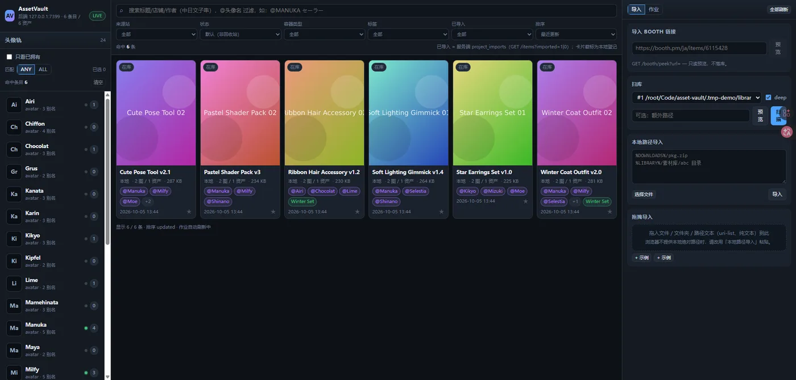

# AssetVault

AssetVault 是面向 **BOOTH、Unity 和 VRChat** 的本地素材库。把分散在各处的压缩包和 UnityPackage 登记起来，就能按 Avatar、分类或文件名找素材。默认就地索引，原始文件保留在原目录。



## 主要功能

- **收录素材**　扫描目录或粘贴 BOOTH 商品链接，整理商品信息、缩略图和本地文件。
- **搜索素材**　支持中日英关键词、BOOTH 编号、Avatar 别名和已索引的包内路径。按 `Ctrl+K` 聚焦搜索框。
- **查看包内文件**　浏览 ZIP、7z、RAR 和 UnityPackage，直接预览支持的图片与文本。
- **导入 Unity**　通过素材工作台选择要导入的包，检查目标工程后再执行导入。

## 快速开始

需要 **Node.js 22 或更新版本**。

```bash
git clone https://github.com/elysia-5201/asset-vault.git
cd asset-vault
npm install
npm run build:web
node --import tsx apps/server/src/main.ts
```

打开 [127.0.0.1:7317](http://127.0.0.1:7317)，在设置里添加素材目录，或粘贴商品链接开始入库。

Windows 便携版可用 `npm run desktop:dist` 构建，入口为 `dist-desktop/win-unpacked/AssetVault.exe`。

## 文档

- [Search 2.0](docs/search-2.0.md) · 搜索语法、索引维护和验收结果
- [Avatar 素材工作台](docs/avatar-workbench.md) · 适配证据与 Unity 导入
- [桌面构建与发布](docs/desktop-release.md) · [HTTP API](docs/api.md)

欢迎通过 [Issues](https://github.com/elysia-5201/asset-vault/issues) 提建议或反馈问题。反馈时请附上复现步骤，并遮盖私人素材路径。项目采用 [MIT 许可证](LICENSE)。
